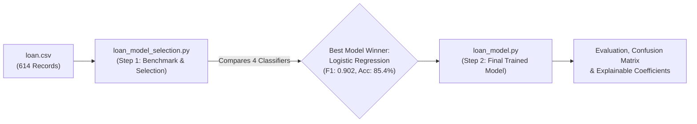

# 🏦 Loan Approval Prediction System

A supervised machine learning classification project that predicts whether a loan application will be **Approved (Y)** or **Rejected (N)** based on applicant demographic, financial, and credit records.

---

## 💡 Project Architecture & Core Idea

The project is structured around a two-step workflow:



### 1. Model Selection & Benchmarking (`loan_model_selection.py`)
* **Role**: Algorithm experimentation and evaluation.
* **What it does**: 
  - Trains and benchmarks **4 different machine learning algorithms** on identical, unseen test data (70% train / 30% test split).
  - Evaluates performance across multiple metrics: **Accuracy**, **Precision**, **Recall**, and **F1-Score**.
  - **Models Compared**:
    1. **Logistic Regression** (Linear Classifier with Scaled Features)
    2. **K-Nearest Neighbors (KNN)** ($k=5$, Distance-Based)
    3. **Decision Tree** (`max_depth=3`, Rule-Based)
    4. **Random Forest** (100 Trees, Ensemble)
  - **Verdict**: **Logistic Regression** achieves the highest F1-score (**0.902**) and highest Accuracy (**85.4%**), proving to be both the top performer and the most explainable model.

### 2. Final Selected Model (`loan_model.py`)
* **Role**: Clean, focused production script implementing our winning model.
* **What it does**:
  - Encapsulates the complete, leak-free pipeline using **Logistic Regression**.
  - Applies median/mode imputation derived strictly from the training set.
  - Scales 14 encoded features using `StandardScaler`.
  - Outputs detailed evaluation metrics, the test set **Confusion Matrix**, and a rank-ordered breakdown of **feature coefficients** showing exactly which factors boost or reduce approval odds.

---

## 📊 Dataset Overview

* **Source File**: `loan.csv`
* **Total Applications**: 614
* **Target Variable**: `Loan_Status` (`Y` = Approved: 422 [68.7%], `N` = Rejected: 192 [31.3%])
* **Applicant Features**:
  - **Demographics**: `Gender`, `Married`, `Dependents`, `Education`, `Self_Employed`
  - **Financials**: `ApplicantIncome`, `CoapplicantIncome`, `LoanAmount`, `Loan_Amount_Term`
  - **Credit & Property**: `Credit_History` (0.0 or 1.0), `Property_Area` (Urban, Semiurban, Rural)

### Leak-Free Preprocessing Strategy
1. **Train/Test Split First**: 70% Training (429 rows) and 30% Testing (185 rows), stratified by `Loan_Status` with fixed `random_state=42`. Splitting before cleaning prevents data leakage.
2. **Imputation**:
   - Numeric features (`LoanAmount`, `Loan_Amount_Term`) filled using the **training median**.
   - Categorical features & `Credit_History` filled using the **training mode**.
3. **Encoding & Scaling**:
   - One-hot encoding (`pd.get_dummies(..., drop_first=True)`) producing **14 numeric features**.
   - `StandardScaler` fitted only on training data and applied to test data.

---

## 🏆 Model Comparison Results

Evaluation on the **185 unseen test applications**:

| Model | Accuracy | Precision | Recall | F1-Score | Status |
| :--- | :---: | :---: | :---: | :---: | :---: |
| 🥇 **Logistic Regression** | **0.854** | **0.838** | **0.976** | **0.902** | **Selected Final Model** |
| 🥈 Random Forest (100 trees, depth=5) | 0.838 | 0.826 | 0.969 | 0.891 | Runner-Up |
| 🥉 Decision Tree (depth=3) | 0.800 | 0.817 | 0.913 | 0.862 | Baseline Tree |
| 4️⃣ K-Nearest Neighbors ($k=5$) | 0.789 | 0.810 | 0.906 | 0.855 | Distance Classifier |

---

## 🔍 Final Model Confusion Matrix & Insights

Confusion matrix of the selected **Logistic Regression** model on 185 test samples:

```
                    Predicted Rejected    Predicted Approved
  Actual Rejected          34 (TN)               24 (FP)
  Actual Approved           3 (FN)              124 (TP)
```

* **Overall Accuracy**: **85.4%** (158 of 185 correct predictions).
* **Exceptional Recall**: **97.6%** — correctly identified 124 out of 127 creditworthy applications, missing only 3 good loans.
* **Precision**: **83.8%** — 24 risky applications were approved out of 148 total approvals.

---

## 📈 Key Drivers Behind Loan Approval

Feature analysis reveals the primary factors governing approval decisions:

| Feature | Coefficient / Importance | Impact Direction | Interpretation |
| :--- | :---: | :---: | :--- |
| **Credit_History** | **+1.19** (LR) / **0.410** (RF) | 🟢 Strong Positive | By far the #1 deciding factor; prior good credit drastically increases approval chance. |
| **Property_Area_Semiurban** | **+0.40** (LR) | 🟢 Positive | Applications in semiurban regions show higher approval odds. |
| **Married_Yes** | **+0.26** (LR) | 🟢 Positive | Married applicants show greater stability and repayment probability. |
| **Dependents_2** | **+0.23** (LR) | 🟢 Positive | Positively associated with approval in the dataset. |
| **Education_Not Graduate** | **-0.21** (LR) | 🔴 Negative | Non-graduate status decreases approval probability. |

---

## 🛠️ Installation & Usage

### 1. Prerequisites
Ensure you have Python 3.8+ installed. Install the required libraries:
```bash
pip install pandas numpy scikit-learn
```

### 2. Run Model Comparison & Selection
To see the comparison between all 4 algorithms and verify the best performer:
```bash
python loan_model_selection.py
```

### 3. Run the Final Model
To train and evaluate the selected Logistic Regression model:
```bash
python loan_model.py
```

---

## 📁 Repository Structure

```
├── loan.csv                                      # Primary dataset (614 rows)
├── loan_model_selection.py                       # Step 1: Compares 4 ML algorithms and selects the best
├── loan_model.py                                 # Step 2: Final trained Logistic Regression pipeline
├── Loan_Approval_Prediction.pptx                 # Project presentation deck
├── Loan_Approval_Prediction_Project_Report.docx  # Detailed academic project report
└── README.md                                     # Project documentation
```

---

## 🎓 Academic Details

* **Program**: B.Tech CSE (AI/ML) – 3rd Semester
* **Course**: Machine Learning
* **Institution**: Sri Sri University

